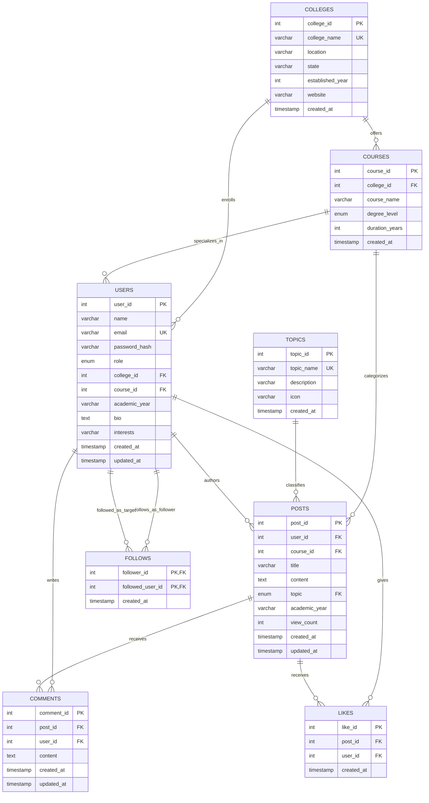

# CampusTalk — Entity-Relationship (ER) Diagram

CampusTalk employs a hybrid **RDBMS (MySQL 8.0)** and **Document NoSQL (MongoDB)** architecture. MySQL manages relational, authoritative domain entities (users, colleges, courses, posts, comments, likes, follows, topics) enforcing ACID properties and referential constraints. MongoDB stores flexible, category-specific student experience reviews.

---

## 1. Relational ER Diagram (MySQL)



---

## 2. NoSQL Document Schema (MongoDB Collection: `student_reviews`)

Reviews have varying schemas depending on the college aspect evaluated (Academics, Placements, Hostels, Campus Life, Fees & ROI). MongoDB allows category-specific fields without introducing dozens of sparse, nullable columns in MySQL.

```json
{
  "_id": "ObjectId('6adef8a9c5625a8e2fbfba5a')",
  "user_id": 1,
  "reviewer_name": "Aarav Sharma",
  "user_role": "current_student",
  "college_id": 1,
  "college_name": "PES University",
  "course_id": 1,
  "course_name": "B.Tech Computer Science and Engineering",
  "academic_year": "2023-2024",
  "category": "Academics",
  "rating": 4,
  "title": "Rigorous curriculum that prepares you thoroughly for industry",
  "review_text": "The academic rigor at PES is unmatched in Bengaluru. The continuous assessment keeps you on your toes...",
  "pros": "Excellent coding culture, modern computing labs, up-to-date syllabus with cloud & AI electives.",
  "cons": "Exams every 4-5 weeks leave little breathing room; attendance policy (85%) is strictly enforced.",
  "advice_to_juniors": "Build projects from semester 1 and take internal exams seriously.",
  "helpful_count": 14,
  "created_at": "ISODate('2026-08-15T10:00:00.000Z')"
}
```

---

## 3. Entity Cardinality & Referential Integrity Rules

| Parent Entity | Child Entity | Relationship | Foreign Key | Delete Rule | Update Rule |
|---|---|---|---|---|---|
| `Colleges` | `Courses` | 1 : N | `Courses.college_id` | `CASCADE` | `CASCADE` |
| `Colleges` | `Users` | 1 : N | `Users.college_id` | `SET NULL` | `CASCADE` |
| `Courses` | `Users` | 1 : N | `Users.course_id` | `SET NULL` | `CASCADE` |
| `Courses` | `Posts` | 1 : N | `Posts.course_id` | `CASCADE` | `CASCADE` |
| `Users` | `Posts` | 1 : N | `Posts.user_id` | `CASCADE` | `CASCADE` |
| `Posts` | `Comments` | 1 : N | `Comments.post_id` | `CASCADE` | `CASCADE` |
| `Users` | `Comments` | 1 : N | `Comments.user_id` | `CASCADE` | `CASCADE` |
| `Posts` | `Likes` | 1 : N | `Likes.post_id` | `CASCADE` | `CASCADE` |
| `Users` | `Likes` | 1 : N | `Likes.user_id` | `CASCADE` | `CASCADE` |
| `Users` | `Follows (Follower)` | 1 : N | `Follows.follower_id` | `CASCADE` | `RESTRICT` |
| `Users` | `Follows (Target)` | 1 : N | `Follows.followed_user_id` | `CASCADE` | `RESTRICT` |
