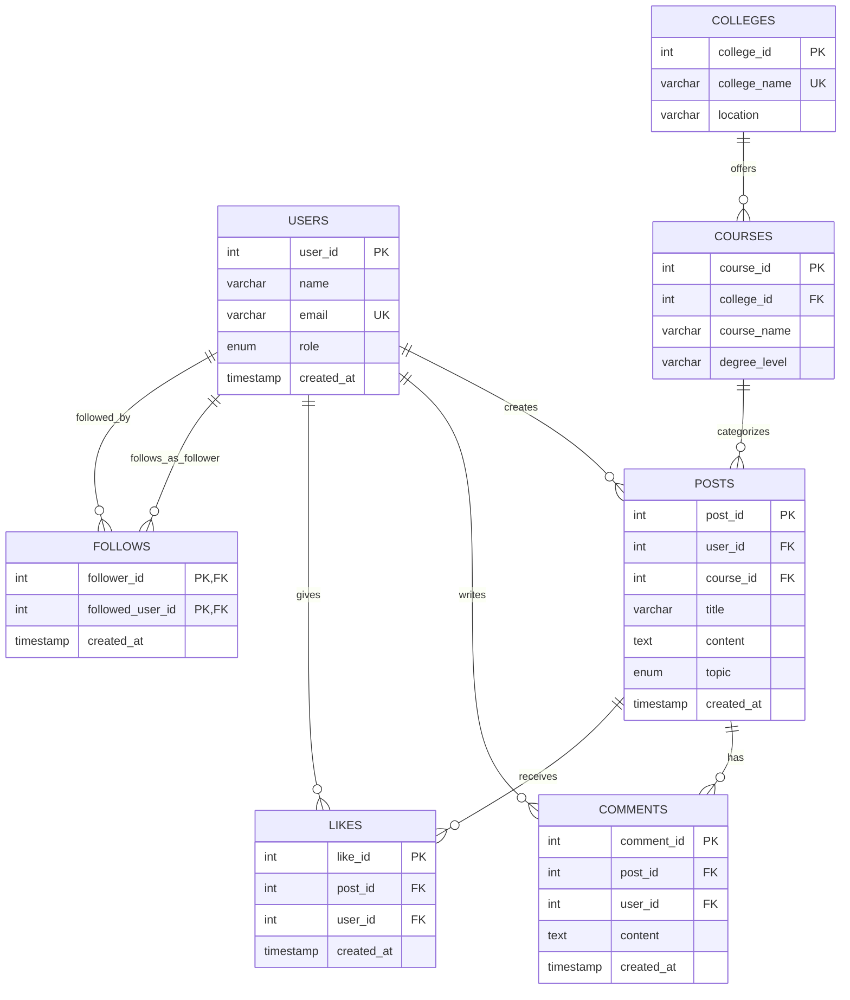

# CampusTalk ER Diagram

## NoSQL collection: `student_reviews` (MongoDB)
Each document contains `college_name`, `course_name`, `reviewer_name`, `category`, `rating`, `review_text`, and `created_at`. Optional fields can be added later (for example `hostel_type`, `placement_year`, or `club_name`) without altering a relational table schema.
