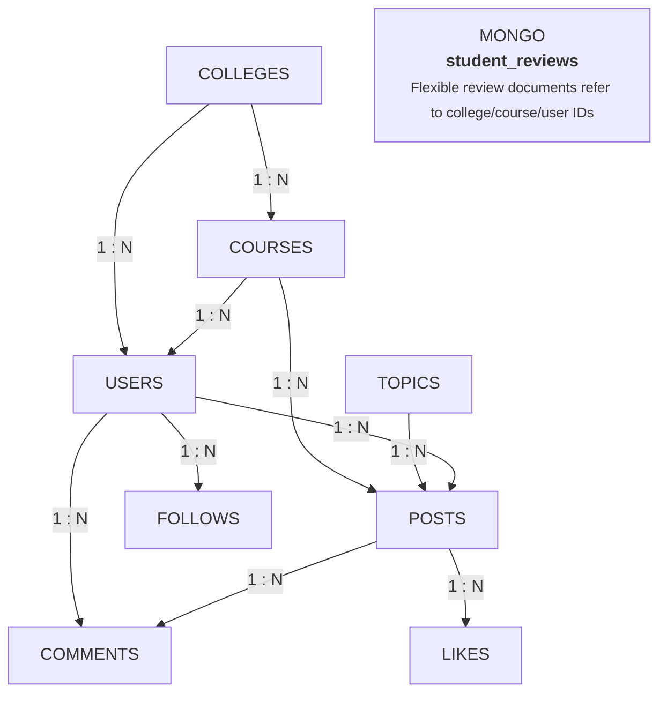
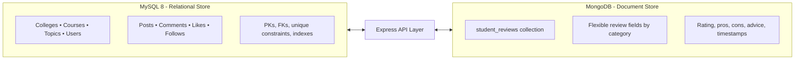

# PES UNIVERSITY
**100 Feet Ring Road, BSK 3rd Stage, Bengaluru – 560085**  
**Department of Computer Science and Engineering**  
*(Artificial Intelligence & Machine Learning)*  
**B. Tech. CSE – 5th Semester**  
**Aug – Dec 2026**  
**UE23CS351A — DATABASE MANAGEMENT SYSTEMS (DBMS)**  

---

# PROJECT REPORT on  
## **CampusTalk – College Student Discussion & Experience Platform**

### Submitted by:

| SRN | Name | Semester |
|---|---|---|
| **PES1UG24AM102** | **GANESH ARODA C** | 5th |
| **PES1UG24AM094** | **DIVYANSH BADAYA** | 5th |

**Class of:** Prof. [Faculty Name]  
**[Lab Faculty]**

---

## Abstract

**CampusTalk** is a college-focused discussion and student-experience platform that connects prospective students with current students. It organizes discussions under colleges, courses and topics, allowing users to ask questions, post answers, comment, like discussions, follow other users and explore student reviews. The system uses a polyglot persistence architecture: MySQL stores structured records and enforces relationships, while MongoDB stores flexible student-review documents. A Node.js and Express backend exposes APIs to a responsive HTML, CSS and vanilla JavaScript frontend. Authentication is implemented using JSON Web Tokens and bcryptjs password hashing. The platform also provides database-backed analytical reports and CSV exports. This report documents the problem, technology choices, ER model, relational schema, SQL/NoSQL operations, application structure and evaluation status.

**Keywords:** DBMS, MySQL, MongoDB, relational model, document database, Express.js, authentication, SQL analytics.

---

## Table of Contents

| Sl. No. | Topic | Page No. |
|---|---|---|
| 1 | Introduction and Problem Statement | 3 |
| 2 | User Requirements and Technology Stack | 4 |
| 3 | E-R Model | 5 |
| 4 | Relational Model and Normalization | 6 |
| 5 | SQL DDL Statements | 7 |
| 6 | SQL DML Statements and Queries | 8 |
| 7 | NoSQL Database Commands | 9 |
| 8 | Results and Database Reports | 10 |
| 9 | Next.js-Project Tree Structure / Application Structure | 11 |
| 10 | Application Screenshots and Demonstration | 12 |
| 11 | Evaluation Rubrics – Completion Status | 13 |
| 12 | Conclusion and References | 14 |

> **Note:** The submitted application is implemented with a vanilla JavaScript frontend and Node.js/Express backend; the template's 'Next.js' heading is retained as an application-structure requirement, but Next.js is not part of the current stack.

---

## 1. Introduction

### 1.1 Problem Statement
Prospective students often find it difficult to obtain reliable, unbiased and first-hand information about colleges and specific degree programmes. Useful discussions are scattered across social-media posts, informal chat groups and promotional websites. Information about academics, placements, hostels, fees, campus life and course workload is therefore difficult to compare or search in one place.

### 1.2 Proposed Solution
CampusTalk provides a centralized platform where discussions are organized by **College &rarr; Course &rarr; Topic**. Current students can share experiences and answer questions, while prospective students can search, filter and compare information. Separate student-review documents capture multi-dimensional experiences such as Academics, Placements, Hostels, Campus Life, Clubs and Fees & ROI.

### 1.3 Objectives
- Provide structured college and course discovery.
- Allow authenticated users to create discussions, comments and likes.
- Support user following and role-based experiences.
- Store core transactional data with relational integrity in MySQL.
- Store flexible review content in MongoDB.
- Generate live analytical reports and downloadable CSV files.
- Protect credentials and enforce ownership checks on write operations.

### 1.4 Scope
The current scope covers registration/login, student profiles, college and course catalogues, topic-based posts, comments, likes, follows, student reviews, database reports and CSV export. Institutional email verification and a dedicated full-text search engine are documented as future enhancements rather than current capabilities.

---

## 2. User Requirements Specification

### 2.1 Functional Requirements

| ID | Requirement |
|---|---|
| **FR-01** | Users can register and sign in securely. |
| **FR-02** | The system distinguishes `current_student`, `prospective_student` and `admin` roles. |
| **FR-03** | Users can browse colleges, courses and topic-based discussions. |
| **FR-04** | Authenticated users can create posts and comments. |
| **FR-05** | Users can like/unlike posts; duplicate likes are prevented. |
| **FR-06** | Users can follow other users. |
| **FR-07** | Students can create category-specific college experience reviews. |
| **FR-08** | Users can filter and sort discussions, including unanswered questions. |
| **FR-09** | The system displays seven database-backed analytical reports and supports CSV export. |
| **FR-10** | Users can edit/delete only content they own; admin has administrative privileges. |

### 2.2 Non-Functional Requirements
- **Security:** bcryptjs password hashing, signed JWTs, parameterized SQL and server-side ownership verification.
- **Integrity:** MySQL primary keys, foreign keys, unique constraints and InnoDB transactions.
- **Usability:** responsive interface with accessible focus states and live status messages.
- **Maintainability:** modular JavaScript, Express routes/controllers and separated database access.
- **Reliability:** automated integration tests for authentication, authorization, CRUD, constraints and reports.

### 2.3 Technology Stack and Justification

| Layer | Technology | Reason for selection |
|---|---|---|
| **Frontend** | HTML5, CSS3, Vanilla JavaScript (ES6+) | Lightweight, responsive interface without a heavy UI framework; modular client-side interactions. |
| **Backend** | Node.js and Express 4.21 | JavaScript across the stack; REST-style API routing and asynchronous I/O. |
| **Relational DB** | MySQL 8.0+ / InnoDB | Structured entities, joins, ACID transactions, foreign keys, unique constraints and indexes. |
| **Document DB** | MongoDB 6/7+ | Flexible review documents with category-specific fields such as pros, cons and advice. |
| **Authentication** | JWT and bcryptjs | Signed stateless access tokens and salted password hashing. |
| **Testing** | node:test and node:assert/strict | Built-in Node testing tools for API and database integration tests. |

### 2.4 Why MongoDB for Reviews?
Student reviews do not always have identical fields. An academic review may emphasize teaching and curriculum, while a hostel review may emphasize accommodation and facilities. MongoDB's document model allows category-specific fields to coexist without adding many nullable columns to a relational table. MySQL remains the authoritative store for users, colleges, courses and discussion interactions; MongoDB stores the flexible review documents. The Express application coordinates operations across both stores.

---

## 3. E-R Model

The ER model contains eight MySQL entities: Colleges, Courses, Topics, Users, Posts, Comments, Likes and Follows. Student reviews are stored separately as MongoDB documents and are not represented as a conventional MySQL entity.

### 3.1 Entities and Attributes

| Entity | Attributes |
|---|---|
| **Colleges** | `college_id` (PK), `college_name` (unique), `location`, `state`, `established_year`, `website`, `created_at` |
| **Courses** | `course_id` (PK), `college_id` (FK), `course_name`, `degree_level`, `duration_years`, `created_at` |
| **Topics** | `topic_id` (PK), `topic_name` (unique), `description`, `icon`, `created_at` |
| **Users** | `user_id` (PK), `name`, `email` (unique), `password_hash`, `role`, `college_id` (FK), `course_id` (FK), `academic_year`, `bio`, `interests`, timestamps |
| **Posts** | `post_id` (PK), `user_id` (FK), `course_id` (FK), `title`, `content`, `topic`, `academic_year`, `view_count`, timestamps |
| **Comments** | `comment_id` (PK), `post_id` (FK), `user_id` (FK), `content`, timestamps |
| **Likes** | `like_id` (PK), `post_id` (FK), `user_id` (FK), `created_at`; unique(`post_id`, `user_id`) |
| **Follows** | `follower_id` (PK/FK), `followed_user_id` (PK/FK), `created_at`; composite primary key |

*Weak entities:* No weak entity is explicitly defined in the documented relational ER model. Likes and Follows are associative/relationship entities implemented as tables with foreign keys; Follows uses a composite primary key.

### 3.2 Relationships and Cardinality

| Parent | Child | Cardinality | Meaning |
|---|---|---|---|
| Colleges | Courses | 1 : N | A college offers multiple courses. |
| Colleges | Users | 1 : N | A college can be associated with many users. |
| Courses | Users | 1 : N | A course can be associated with many users. |
| Courses | Posts | 1 : N | A course can have many discussion posts. |
| Topics | Posts | 1 : N | A topic classifies many posts. |
| Users | Posts | 1 : N | A user can author many posts. |
| Posts | Comments | 1 : N | A post can receive many comments. |
| Users | Comments | 1 : N | A user can write many comments. |
| Posts | Likes | 1 : N | A post can receive many likes. |
| Users | Follows | 1 : N | A user can follow and be followed by multiple users. |

### 3.3 ER Diagram Snapshot


*Figure 1. High-level ER model of CampusTalk.*

### 3.4 Non-Simple Attributes
The schema includes composite concepts represented through separate attributes rather than a single composite field: user identity/profile details, college location details, course programme details and review content. The MongoDB review document contains flexible descriptive fields (`review_text`, `pros`, `cons` and `advice_to_juniors`) and a rating value.

---

## 4. Relational Model

### 4.1 Relations

| Relation | Primary Key | Foreign Keys / Constraints |
|---|---|---|
| **Colleges** | `college_id` | `college_name` UNIQUE |
| **Courses** | `course_id` | `college_id` &rarr; Colleges; UNIQUE(`college_id`, `course_name`) |
| **Topics** | `topic_id` | `topic_name` UNIQUE |
| **Users** | `user_id` | `email` UNIQUE; `college_id` &rarr; Colleges; `course_id` &rarr; Courses |
| **Posts** | `post_id` | `user_id` &rarr; Users; `course_id` &rarr; Courses |
| **Comments** | `comment_id` | `post_id` &rarr; Posts; `user_id` &rarr; Users |
| **Likes** | `like_id` | `post_id` &rarr; Posts; `user_id` &rarr; Users; UNIQUE(`post_id`, `user_id`) |
| **Follows** | (`follower_id`, `followed_user_id`) | Both columns reference Users; no-self-follow check |

The eight relations above correspond to the entities/associative entities in the ER model. No additional independent relational junction table is identified in the published schema beyond Likes and Follows.

### 4.2 Schema Diagram


*Figure 2. Polyglot persistence architecture.*

### 4.3 Normalization
- **First Normal Form (1NF):** Attributes are atomic; repeating groups such as multiple comments or likes are stored in separate relations.
- **Second Normal Form (2NF):** The design meets 1NF, and non-key attributes depend on the complete candidate key. In `Follows`, `created_at` depends on the complete composite key.
- **Third Normal Form (3NF):** Non-key attributes do not depend transitively on other non-key attributes. College details are stored in `Colleges` rather than duplicated in `Posts`.
- **Boyce-Codd Normal Form (BCNF):** For each non-trivial functional dependency, the determinant is a superkey. `Courses` uses `course_id` and the alternate key (`college_id`, `course_name`).

### 4.4 Integrity Constraints
- Primary keys uniquely identify rows.
- Foreign keys enforce parent-child relationships.
- Deleting a college cascades to its courses; user college/course references may be set to NULL.
- Deleting a post cascades to its comments and likes.
- The unique constraint on (`post_id`, `user_id`) prevents duplicate likes.
- The `Follows` composite key prevents duplicate follow relationships; a check constraint prevents self-following.

---

## 5. SQL DDL Statements

The repository documents an automated database setup command (`npm run setup-db`) that creates the `campustalk` database and eight relational tables with constraints and indexes. The following DDL fragments illustrate the core table definitions and key constraints documented for the project.

```sql
CREATE DATABASE IF NOT EXISTS campustalk;
USE campustalk;

CREATE TABLE Colleges (
  college_id INT AUTO_INCREMENT PRIMARY KEY,
  college_name VARCHAR(150) NOT NULL UNIQUE,
  location VARCHAR(150) NOT NULL,
  state VARCHAR(100) NOT NULL DEFAULT 'Karnataka',
  established_year INT NULL,
  website VARCHAR(200) NULL,
  created_at TIMESTAMP DEFAULT CURRENT_TIMESTAMP
) ENGINE=InnoDB;

CREATE TABLE Courses (
  course_id INT AUTO_INCREMENT PRIMARY KEY,
  college_id INT NOT NULL,
  course_name VARCHAR(150) NOT NULL,
  degree_level ENUM('Undergraduate','Postgraduate','Diploma','Doctorate') DEFAULT 'Undergraduate',
  duration_years INT DEFAULT 4,
  created_at TIMESTAMP DEFAULT CURRENT_TIMESTAMP,
  CONSTRAINT fk_courses_college FOREIGN KEY (college_id)
    REFERENCES Colleges(college_id) ON DELETE CASCADE ON UPDATE CASCADE,
  CONSTRAINT uq_college_course UNIQUE (college_id, course_name)
) ENGINE=InnoDB;

CREATE TABLE Likes (
  like_id INT AUTO_INCREMENT PRIMARY KEY,
  post_id INT NOT NULL,
  user_id INT NOT NULL,
  created_at TIMESTAMP DEFAULT CURRENT_TIMESTAMP,
  CONSTRAINT uq_likes_post_user UNIQUE (post_id, user_id),
  FOREIGN KEY (post_id) REFERENCES Posts(post_id) ON DELETE CASCADE,
  FOREIGN KEY (user_id) REFERENCES Users(user_id) ON DELETE CASCADE
) ENGINE=InnoDB;
```

The full implementation contains the remaining tables (Topics, Users, Posts, Comments and Follows), indexes and constraints. For exact executable definitions, use the SQL scripts in the repository's `sql/` directory and the `setup-db` script. The fragments above are representative report excerpts, not a replacement for the migration files.

### 5.1 Indexing and Constraints
The schema documents indexes on college name/location, course college/name, user email/role/college, post user/course/topic/created_at, comment post/user/created_at, like post/user and followed_user_id. Unique and foreign-key constraints protect identity and relationship integrity.

---

## 6. SQL DML Statements and Queries

### 6.1 CRUD Examples

**INSERT – create a discussion topic:**
```sql
INSERT INTO Topics (topic_name, description, icon)
VALUES ('Placements', 'Placement preparation and outcomes', 'briefcase');
```

**SELECT – retrieve recent posts:**
```sql
SELECT post_id, title, topic, created_at
FROM Posts ORDER BY created_at DESC LIMIT 10;
```

**UPDATE – update a profile biography:**
```sql
UPDATE Users SET bio = 'Computer science student'
WHERE user_id = 1;
```

**DELETE – remove a comment owned by a user:**
```sql
DELETE FROM Comments
WHERE comment_id = 10 AND user_id = 1;
```

### 6.2 Join Query – College Discussion Activity
```sql
SELECT cl.college_name,
       COUNT(DISTINCT p.post_id) AS total_posts,
       COUNT(DISTINCT cm.comment_id) AS total_comments,
       COUNT(DISTINCT l.like_id) AS total_likes
FROM Colleges cl
LEFT JOIN Courses c ON c.college_id = cl.college_id
LEFT JOIN Posts p ON p.course_id = c.course_id
LEFT JOIN Comments cm ON cm.post_id = p.post_id
LEFT JOIN Likes l ON l.post_id = p.post_id
GROUP BY cl.college_id, cl.college_name
ORDER BY total_posts DESC;
```
`LEFT JOIN` keeps colleges with zero discussions in the output. `COUNT(DISTINCT)` avoids inflated counts when a post has multiple comments and likes.

### 6.3 Nested Query – Percentage of Posts by Topic
```sql
SELECT topic, COUNT(*) AS total_posts,
       ROUND(COUNT(*) * 100.0 / (SELECT NULLIF(COUNT(*),0) FROM Posts), 1) AS percentage
FROM Posts
GROUP BY topic
ORDER BY total_posts DESC;
```

### 6.4 Unanswered Questions
```sql
SELECT p.post_id, p.title, p.content
FROM Posts p
LEFT JOIN Comments c ON c.post_id = p.post_id
GROUP BY p.post_id, p.title, p.content
HAVING COUNT(c.comment_id) = 0;
```
The unanswered-question filter is a key feature: it identifies posts with zero comments so current students can prioritize questions that still need responses.

### 6.5 Composite Engagement Score
```sql
SELECT p.post_id, p.title,
       COUNT(DISTINCT l.like_id) * 2 + COUNT(DISTINCT c.comment_id) * 3 AS usefulness_score
FROM Posts p
LEFT JOIN Likes l ON l.post_id = p.post_id
LEFT JOIN Comments c ON c.post_id = p.post_id
GROUP BY p.post_id, p.title
ORDER BY usefulness_score DESC LIMIT 10;
```
The project documentation describes the usefulness heuristic as `2 × Likes + 3 × Comments`. The repository's reports document JOIN, GROUP BY, HAVING, subquery, aggregate and sorting operations. Stored procedures, triggers and recursive CTEs are not claimed as implemented in the current README; they should only be marked complete if corresponding SQL objects are present in the submitted database.

---

## 7. NoSQL Database Commands

MongoDB stores review documents in the `student_reviews` collection. Each document can contain category-specific descriptive fields, numeric rating, reviewer metadata and college/course identifiers.

### 7.1 Sample Document Structure
```javascript
db.student_reviews.insertOne({
  user_id: 1,
  reviewer_name: 'Sample Student',
  user_role: 'current_student',
  college_id: 1,
  college_name: 'PES University',
  course_id: 1,
  course_name: 'B.Tech Computer Science and Engineering',
  category: 'Academics',
  rating: 4,
  title: 'Academic experience',
  review_text: 'Review text...',
  pros: 'Supportive learning environment',
  cons: 'Fast-paced assessment schedule',
  advice_to_juniors: 'Build projects consistently',
  helpful_count: 0,
  created_at: new Date()
});
```

### 7.2 Create / Read / Update / Delete
```javascript
// Create
db.student_reviews.insertOne({ college_id: 1, category: 'Hostels', rating: 4, review_text: 'Sample review' });

// Read
db.student_reviews.find({ college_id: 1, category: 'Hostels' });

// Update
db.student_reviews.updateOne({ _id: reviewId }, { $set: { rating: 5 } });

// Delete
db.student_reviews.deleteOne({ _id: reviewId });
```

### 7.3 Aggregation – Average Rating by College and Course
```javascript
db.student_reviews.aggregate([
  {
    $group: {
      _id: { college: '$college_name', course: '$course_name' },
      avg_rating: { $avg: '$rating' },
      min_rating: { $min: '$rating' },
      max_rating: { $max: '$rating' },
      total_reviews: { $sum: 1 }
    }
  },
  {
    $project: {
      college_name: '$_id.college',
      course_name: '$_id.course',
      avg_rating: { $round: ['$avg_rating', 2] },
      min_rating: 1,
      max_rating: 1,
      total_reviews: 1,
      _id: 0
    }
  },
  {
    $sort: { avg_rating: -1, total_reviews: -1 }
  }
]);
```

### 7.4 Indexing
The repository documents compound indexes for review queries and aggregation-oriented access. Indexes should be aligned with the actual filter fields used by the application, such as `college_id`, `course_id`, `category` and `rating`. Exact index definitions should be verified in the MongoDB setup script before the final viva.

---

## 8. Results

The project documentation describes seven live database-backed reports. The report endpoints query persisted MySQL/MongoDB data rather than hardcoded dashboard values. Each report can be exported as CSV through `/api/reports/export/:reportType`.

| No. | Report | Database / Concepts |
|---|---|---|
| **1** | College-wise discussion activity | MySQL LEFT JOIN, GROUP BY, COUNT(DISTINCT) |
| **2** | Course-wise discussion activity | MySQL multi-table joins and aggregation |
| **3** | Most discussed topics and percentage share | MySQL subquery, ROUND and aggregate calculation |
| **4** | Most useful discussions | MySQL joins and weighted engagement score |
| **5** | Average review rating by college and course | MongoDB $group, $avg, $min, $max, $project, $sort |
| **6** | Review counts by college and category | MongoDB compound grouping |
| **7** | Monthly discussion and review timeline | MySQL DATE_FORMAT + MongoDB $dateToString; merged by API |

### 8.1 Test and Verification Results
The repository README reports an automated integration test suite covering health checks, authentication, authorization, CRUD operations, database constraints, MongoDB aggregations and report exports. The documented expected test summary is 10 tests passed and 0 failed.

| Verification area | Documented coverage |
|---|---|
| Authentication | Registration/login and password hashing |
| Authorization | Role checks and ownership enforcement |
| CRUD | Create/read/update/delete API operations |
| Database integrity | Constraints and relational relationships |
| NoSQL | MongoDB aggregation pipelines |
| Analytics | Report endpoints and CSV export |

### 8.2 Screenshot Evidence
The template requests screenshots of resulting tables and application output. Genuine screenshots from your running local application:
1. MySQL Workbench/CLI showing the eight tables and `DESCRIBE` output.
2. MongoDB Compass showing the `student_reviews` collection and sample document.
3. Application home/discussion feed and college/course filters.
4. Post creation, comments and like interaction.
5. Student review page.
6. DBMS reports dashboard with one report and CSV export.
7. Terminal showing `npm test` output from your machine.

---

## 9. Application Project Structure

The supplied project uses Node.js/Express with a static HTML/CSS/vanilla JavaScript client. It is not a Next.js application; the template's Next.js heading is therefore interpreted as the requested project-tree section.

```text
CampusTalk/
├── docs/                 # ER diagram, relational schema, DB design, reports, viva notes, project report
├── public/               # Static frontend assets (HTML, CSS, client-side JS)
├── scripts/              # Database setup, seeding and utility scripts
├── sql/                  # MySQL schema / SQL scripts
├── src/                  # Express application modules, routes and database logic
├── tests/                # Automated integration tests
├── .env.example          # Environment variable template
├── .gitignore
├── README.md
├── package.json
├── package-lock.json
└── server.js             # Application entry point
```

### 9.1 Execution Steps
1. Install Node.js (v18 or newer), MySQL 8.0+ and MongoDB 6/7+.
2. Clone the repository and open the CampusTalk folder.
3. Run: `npm install`
4. Copy `.env.example` to `.env` and configure local MySQL, MongoDB and JWT settings.
5. Run: `npm run setup-db`
6. Start the application: `npm start`
7. Open the local URL printed by the server (README documents `http://localhost:5000`).
8. Run tests using: `npm test`

---

## 10. Application Demonstration

### 10.1 Demonstration Flow
1. Open the CampusTalk landing/home page and explain the purpose of the platform.
2. Register or sign in using a seeded demonstration account configured in the local environment.
3. Show the college and course discovery pages and explain how filters organize information.
4. Open discussions, filter by topic and show the unanswered-question filter.
5. Create a post, add a comment and toggle a like to demonstrate CRUD and relationship tables.
6. Open student reviews and explain why review documents are stored in MongoDB.
7. Open the DBMS reports section and demonstrate a MySQL report and a MongoDB aggregation report.
8. Export a report as CSV and explain the API endpoint.
9. Briefly show role-based access and ownership checks.

### 10.2 Evidence Slots

| Evidence | Screenshot to insert |
|---|---|
| Figure 3 | Home / discussion feed |
| Figure 4 | College and course discovery filters |
| Figure 5 | Post, comment and like interaction |
| Figure 6 | Student review detail |
| Figure 7 | MySQL tables and relational records |
| Figure 8 | MongoDB student_reviews collection |
| Figure 9 | DBMS reports dashboard and CSV export |
| Figure 10 | Automated test output |

---

## 11. Evaluation Rubrics – Completion Status

| # | Criteria | Requirement | CampusTalk evidence / note | Status |
|---|---|---|---|---|
| 1 | Database Design | ER diagram, relational schema, keys, relationships and constraints | Documented in repository; verify diagram and schema against final DB | Implemented / documented |
| 2 | Database Creation | MySQL DDL, NoSQL collection and technology justification | Setup script documented; MySQL + MongoDB architecture described | Implemented / documented |
| 3 | SQL Operations and Queries | DML, nested queries, joins, grouping and reports | CRUD and seven analytical reports documented | Implemented / documented |
| 4 | Advanced DB Concepts | Procedures/functions, triggers, CTE; NoSQL CRUD/aggregation | MongoDB CRUD/aggregation documented; procedures/triggers/CTEs not verified | Partial / verify |
| 5 | Web Application and DB Integration | Frontend, backend/API and database integration | HTML/CSS/JS frontend, Express API, MySQL and MongoDB documented | Implemented / documented |
| 6 | Authentication and Authorization | Authentication, minimum two roles and role-based access | JWT, bcryptjs and current_student/prospective_student/admin roles documented | Implemented / documented |
| 7 | Documentation, Git/GitHub, Demo, Testing and Originality | Documentation, repository, demonstration, testing and individual contribution | Public repository and docs available; screenshots and contribution split need team confirmation | Partial / verify |

### 11.1 Team Contribution

| Team Member | SRN | Contribution area |
|---|---|---|
| **Ganesh Aroda C** | PES1UG24AM102 | To be completed by the team based on actual work performed. |
| **Divyansh Badaya** | PES1UG24AM094 | To be completed by the team based on actual work performed. |

---

## 12. Conclusion

CampusTalk demonstrates how a college discussion and experience-sharing application can use relational and document databases together. MySQL provides structured storage and referential integrity for users, colleges, courses, discussions and interactions. MongoDB supports flexible student reviews with category-specific attributes. The Express API connects both stores to a responsive web interface, while authentication, authorization, analytical reports and CSV export provide practical application-level functionality. The project also demonstrates important DBMS concepts including normalization, primary and foreign keys, joins, aggregation, nested queries, constraints and NoSQL pipelines.

### Future Enhancements
- Institutional email verification for current-student status.
- Dedicated full-text search for large discussion collections.
- More robust cross-database consistency handling if workflows become transaction-critical.
- Additional verified moderation and review quality controls.

### References
- CampusTalk GitHub repository: https://github.com/Ganesh-Aroda-C/CampusTalk
- `docs/ER_DIAGRAM.md` – Entity relationship model and MongoDB review document.
- `docs/RELATIONAL_SCHEMA.md` – Relational schema, constraints and normalization.
- `docs/DATABASE_DESIGN.md` – Polyglot persistence and consistency strategy.
- `docs/REPORTS_AND_SQL.md` – Seven analytical reports and SQL/MongoDB aggregation queries.
- PES University, UE23CS351A Database Management Systems Project Report Template.
